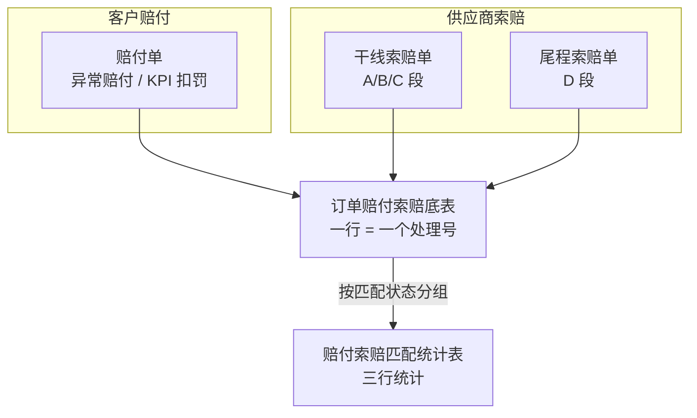
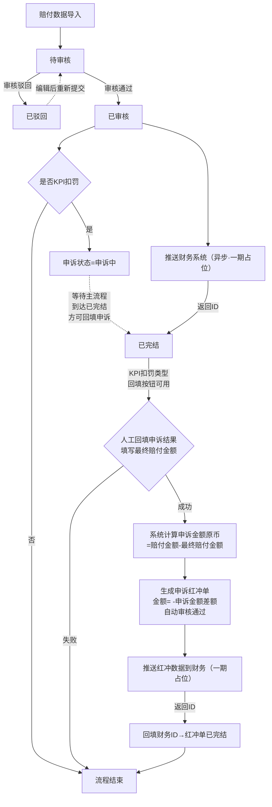
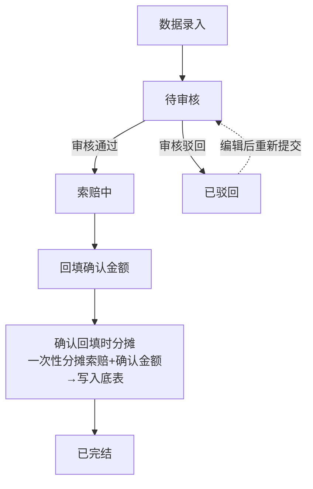
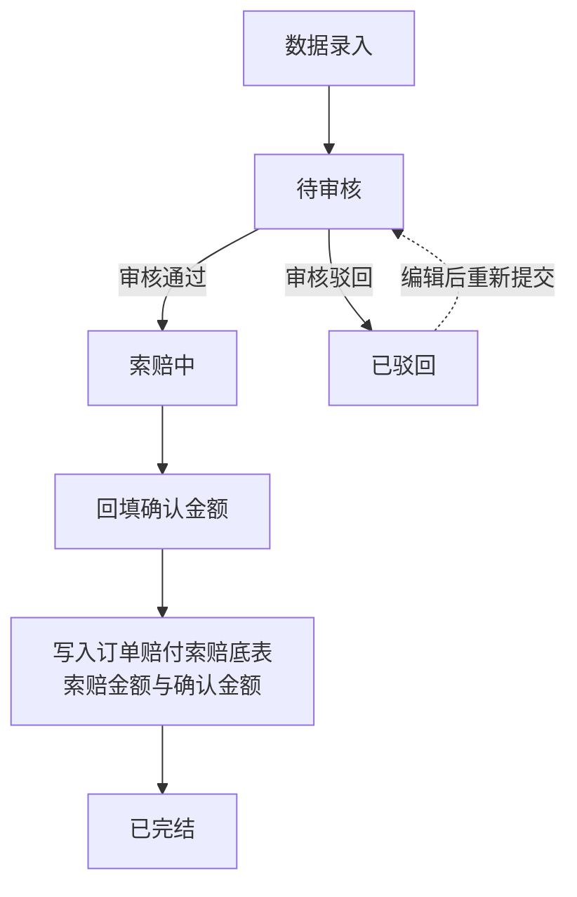

# 00 认识系统

> 本章是全手册唯一的整体讲解处：系统管什么、单据怎么流转、核心口径是什么。后续各章只讲具体操作，不重述本章内容。

---

## 1.1 系统定位与一期边界

理赔系统统一管理小包业务的**客户赔付**与**供应商索赔**两类数据，并在订单维度汇聚为统一底表，支撑赔付/索赔净额分析与责任判定。

业务分为四条线，归入两个相互独立的业务范畴——客户赔付与供应商索赔各自发起、互不联动：

| 业务范畴 | 业务线 | 数据维度 | 说明 |
| --- | --- | --- | --- |
| 客户赔付 | 客户赔付-主流程（异常赔付） | 订单维度 | 标准赔付流程 |
| 客户赔付 | 客户赔付-平台扣罚（KPI 扣罚） | 订单维度 | 涉及平台扣罚及申诉，仅客户赔付支持申诉 |
| 供应商索赔 | 干线索赔（A/B/C 段） | 运单维度（可按箱子/订单维度录入） | 按计费重占比分摊至订单 |
| 供应商索赔 | 尾程索赔（D 段） | 订单维度 | 直接关联订单，无需分摊 |

**一期边界**：

- 一期仅覆盖小包业务，外销业务不在一期范围内；
- 「推送财务」为一期占位：系统只回填固定财务 ID、不实际推送；实际由人工将赔付数据导入财务系统，赔付成本在系统内如实记录；
- 供应商索赔（干线/尾程）不推送外部系统，回填确认金额后在系统内完结；
- 系统不跟踪客户与供应商的实际结算、收款确认状态。

---

## 1.2 单据的一生

三类单据各自走状态机，最终都汇聚到订单赔付索赔底表，再由统计表按匹配状态分组：

红冲单由原单派生，同一条业务线上的红冲沿用该业务线对应单据的处理逻辑（客户赔付的红冲赔付单走客户赔付流程，见 01 §2.5；干线、尾程的红冲索赔单走各自索赔流程，见 02 §3.6、03 §4.6）。红冲单自身的状态机与单据类型见下方「红冲单」小节。

### 客户赔付单

**赔付状态**：

| 状态 | 含义 | 该状态下的行内操作 |
| --- | --- | --- |
| 待审核 | 数据已录入，等待审核 | 审核、编辑、删除 |
| 已驳回 | 审核未通过 | 编辑、删除（编辑保存后回到待审核） |
| 已审核 | 审核通过，等待回填财务 ID（一期固定值） | 无 |
| 已完结 | 财务 ID 已回填，流程结束 | 红冲 |

**申诉状态**（仅 KPI 扣罚类型，异常赔付无此字段）：

| 状态 | 含义 | 该状态下的行内操作 |
| --- | --- | --- |
| 申诉中 | 审核通过后自动标记，等待回填结果 | 回填申诉（须赔付已完结） |
| 申诉成功 | 系统已生成申诉红冲单 | 无 |
| 申诉失败 | 申诉流程结束 | 无 |

### 干线索赔单

**索赔状态**（干线、尾程相同）：

| 状态 | 含义 | 该状态下的行内操作 |
| --- | --- | --- |
| 待审核 | 数据已录入，等待审核 | 审核、编辑、删除 |
| 已驳回 | 审核未通过 | 编辑、删除（编辑保存后回到待审核） |
| 索赔中 | 审核通过，等待回填供应商确认金额 | 回填确认（干线同时触发分摊） |
| 已完结 | 回填确认金额后完结，写入底表 | 红冲 |

### 尾程索赔单

索赔状态与干线相同（见上表）。

### 红冲单

红冲单复用所属单据的状态机，用于对冲原单：

- **客户赔付红冲单**：待审核 → 已审核 → 已完结（已驳回时可删除红冲单后重新发起）。其中申诉红冲单由系统自动生成、自动审核通过；主动红冲单需人工审核。
- **供应商索赔红冲单**：待审核 → 已完结。审核通过时系统自动填入确认金额 = −原单确认金额，取负复制原单底表记录、不再重新分摊，随即直接完结（不停留在【索赔中】）；已驳回时可删除红冲单后重新发起。

**单据类型**字段用于区分原单与红冲单：客户侧为 正常赔付 / 红冲赔付；供应商侧为 正常索赔 / 红冲索赔。

---

## 1.3 核心口径与术语速查

### 匹配状态三值

底表以处理号为维度汇总后，根据**赔付次数**与**索赔次数**判定匹配状态（用次数而非金额判断，避免红冲抵消后金额合计为 0 被误判为"无赔付/无索赔"）：

| 匹配状态 | 判定条件 | 业务含义 |
| --- | --- | --- |
| 有赔付无索赔 | 赔付次数 > 0 且 索赔次数 = 0 | 已赔付客户但未向供应商发起索赔，存在漏索赔风险 |
| 有索赔无赔付 | 赔付次数 = 0 且 索赔次数 > 0 | 已向供应商索赔但无客户赔付，可能为供应商责任索赔或数据异常 |
| 有赔付有索赔 | 赔付次数 > 0 且 索赔次数 > 0 | 同时有赔付和索赔，匹配分布参考 |

赔付索赔匹配统计表即按底表的【匹配状态】字段分组统计。

### 汇率取值规则

- 赔付汇率、索赔汇率、确认汇率：均按该单**审核通过时间**取成本系统对应币种的 CNY 汇率；
- 申诉汇率：取原赔付单的赔付汇率（原单审核通过时即确定，申诉时不重新取汇率）；
- CNY 金额 = 原币金额 × 对应汇率（赔付金额 CNY、索赔金额 CNY、申诉金额 CNY、确认金额 CNY 同规则）；
- **红冲单一律复制原单汇率**（赔付汇率 / 索赔汇率 / 申诉汇率 / 确认汇率均复制原单），不按红冲单自身审核时点重新取汇率，确保红冲 CNY = −原单 CNY，与原单精确对冲。

**示例**（同一张赔付单及其红冲单）：

| 单据 | 原币金额 | 采用的汇率 | CNY |
| --- | --- | --- | --- |
| 原赔付单 | USD 100.00 | 7.1000（原单审核通过时汇率） | 710.00 |
| 红冲赔付单 | -USD 100.00 | 7.1000（复制原单） | -710.00 |
| 若红冲改按当期 7.2000 取 | -USD 100.00 | 7.2000 | -720.00，多冲 10.00，与原单对冲不干净 |

### 分摊规则（仅干线）

- 干线索赔按**计费重占比**分摊至订单：订单分摊金额 = 索赔金额 ×（该订单计费重 ÷ 分摊范围内订单计费重合计）；
- 分摊范围由录入维度决定：按运单 = 运单下全部订单；按箱子 = 指定箱子下全部订单；按订单 = 指定订单；
- 分摊时机：回填确认金额时，按最新计费重占比对索赔金额与确认金额**一次性分摊**并写入底表；
- 精度：原币按国际标准精度四舍五入（CNY/USD/EUR 保留 2 位小数，JPY 保留 0 位）；非 CNY 币种的 CNY 分摊结果保留 4 位小数；
- 分摊状态：未分摊 / 分摊中 / 已分摊。

### 术语

| 术语 | 含义 |
| --- | --- |
| 处理号 | 内部订单唯一键值（OMS 订单号）；与「客单号」是两个不同字段 |
| 客单号 | 客户订单号 |
| 红冲 | 生成一张金额为负的红冲单对冲原单。分主动红冲（人工发起，需人工审核）与申诉红冲（KPI 扣罚申诉成功时系统自动按差额生成，自动审核通过；仅客户赔付有） |
| 申诉 | 仅 KPI 扣罚类型的赔付单支持：回填最终赔付金额后，系统按「赔付金额 − 最终赔付金额」的差额生成申诉红冲单 |
| 分摊 | 干线索赔金额按计费重占比拆分到分摊范围内各订单 |
| 单据 ID 前缀 | PYC = 客户赔付，CLA = 干线索赔，CLD = 尾程索赔 |

---

## 1.4 单据进入终态后只能红冲

以下动作执行后，原单进入终态，系统不再提供编辑与删除入口。之后要纠正只能给这张单开红冲单反向冲销，红冲单独立走审核，不与原单联动。

| 动作 | 单据变化 | 说明 |
| --- | --- | --- |
| 审核通过 | 原单【已审核】 | 编辑、删除入口消失；改错只能红冲原单后重新录入 |
| 回填申诉成功 | 原单保持【已完结】，另生成一张已完结的申诉红冲单 | 系统自动审核通过并回填财务 ID，不经人工；申诉结果提交后不能再改 |
| 回填确认金额（供应商索赔） | 原单【已完结】 | 金额填错同样只能红冲重录；干线在此时按计费重一次性分摊，分摊结果随之固定 |
