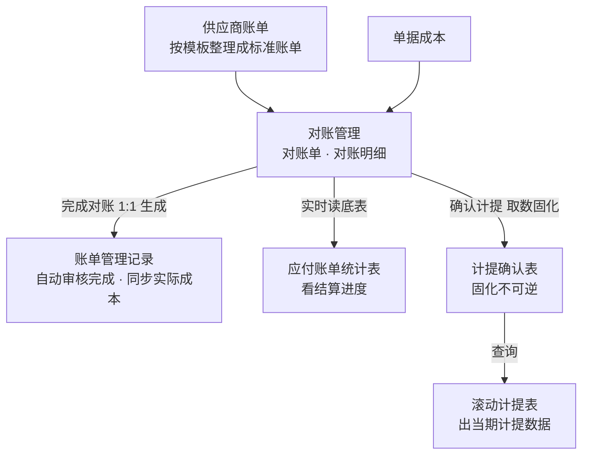
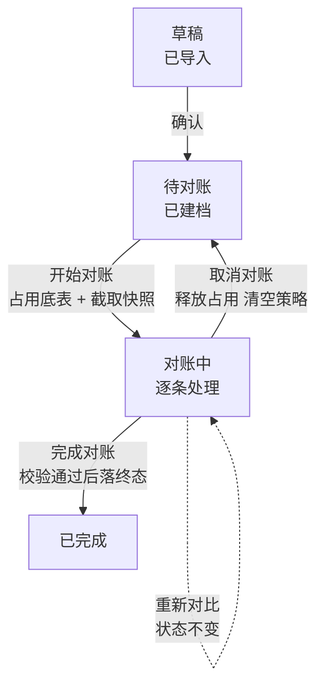
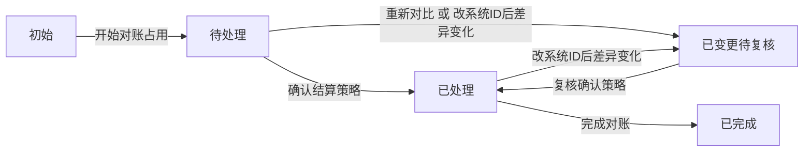

# 01 认识系统

> 本章是全手册唯一的整体讲解处：系统管什么、一张对账单怎么流转、几个关键口径是什么。后续各章只讲具体操作，不重述本章内容。

---

## 1.1 本需求管什么

本需求负责对账这条线从账单进来到结果交出：供应商按各自账期把账单发过来，**按系统模板整理成标准账单后导入**；系统把它和内部计算成本**按费用项逐条对上**，标出差异，确认每一笔怎么结，完成对账后生成账单管理记录。**到这里为止——入账、付款执行不在本需求内。**

| 本需求内（要在这操作） | 只交接、不操作 |
| --- | --- |
| **对账管理**：导入账单、开始对账、逐条定策略、完成对账 | **账单管理**：入账与付款执行；本需求只负责 1:1 生成记录并回写账单管理ID |
| **清账单**：超半年未结算的记录，一键跑完整个对账流程 | **单据成本**：单据与计算成本在单据侧维护，本需求只读取 |
| **应付账单统计表**：看结算进度、跟进未结 | **供应商实际结算 / 收款确认**：本需求无对应功能，也没有对应字段 |
| **确认计提与滚动计提表**：确认时固化当期数据，滚动计提表按固化数据出数 | — |

**账单类型从哪来**：按成本段分四段——A 段国内转运；B 段内地空运 / 香港空运 / 空运卡转；C 段国外清关 / 国外转运；D 段尾程派送。A、B、C 段以**运单**为单据维度，D 段以**订单**为维度；同一成本段内的标准费用项集合一致。账单上的「账单类型」就是这七种。

**对账这条线不做调差**：计算成本和实际成本之间的差异不强制抹平，系统只把差异记录下来供统计和分析，两边原始数据各自保留。所以系统里能看到的任何差异都不会被"改平"。

---

## 1.2 一张对账单的一生

| 状态 | 含义 | 能做什么 |
| --- | --- | --- |
| **草稿** | 账单已导入，账单头信息还可改 | 编辑基础信息、保存、确认；删除 |
| **待对账** | 已建档，尚未与系统数据做匹配 | 开始对账；删除 |
| **对账中** | 系统侧已完成：底表已占用、快照已截取、差异已判出；剩下的是逐条确认结算策略，**这一步系统不代劳** | 定结算策略、批量改、作废、重新对比、取消对账、完成对账 |
| **已完成** | 终态，对账数据锁定；账单管理数据随后生成，并由账单管理侧自动审核完成（生成失败时「是否生成账单」=否，走重新生成，对账状态不变） | 看、下载；生成失败时可「重新生成」。**对账数据不能再改** |

两点要记住：

- **导入不占用底表**。草稿和待对账期间，底表记录仍是自由态，可以被别的对账单抢先用掉；直到点「开始对账」才锁定。
- **已完成为终态，不可回退**。要调整只能走业务冲销——追加一张负数账单重新对账，不提供状态退返。

---

## 1.3 三套口径速查

财务在对账页面上会同时碰到"状态""金额""差异类型"三套枚举，先在这里认全，后面各章不再重复解释。

### 1.3.1 两个金额：最新计算金额与快照计算金额

系统对同一笔费用同时维护两个计算金额，用途完全不同：

| 口径 | 怎么来 | 会变吗 | 用在哪 |
| --- | --- | --- | --- |
| **最新计算金额** | 单据侧成本变化时实时同步到底表 | 一直变，不受明细状态限制 | 应付账单统计表、滚动计提表的暂估；差异判定里判断"有没有计费" |
| **快照计算金额** | 开始对账占用底表时截取一次；重新对比时再截一次 | 截取后固定，不再随单据变化 | 对账比价、差异判定、对账结果汇总 |

为什么要分开：计算成本会因为费率规则调整持续变动，如果对账直接对着实时金额比，同一张账单今天和明天算出来的差异会不一样，对账结果就不可追溯。所以**对账只看快照，报表计提才看最新值**——两条线各走各的。

三个边界要知道：

- **为空就是空，页面不补 0**：最新计算金额为空时，快照也截为空——明细页的快照计算金额、计算差异都显示空。
- **只有算合计时才当 0**：应付账单统计表、计提暂估把**最新计算金额**的空当 0 参与计算；下载对账结果汇总把**快照计算金额**的空当 0 参与合计。这三处只影响合计结果，不改页面上显示的空。
- 币种不一致时截不到快照，快照为空，不进入金额比对。

### 1.3.2 明细状态五种

明细状态描述的是**这条底表记录走到哪一步了**，和对账单状态不是一回事。

| 明细状态 | 含义 |
| --- | --- |
| **初始** | 未被任何对账单占用，可被分配 |
| **待处理** | 系统已比对完成，等财务确认结算策略 |
| **已处理** | 已选定结算策略 |
| **已变更待复核** | 差异类型变了，需要重新看一遍。来源有两个：重新对比（只影响没定策略的明细）、用处理文件改系统ID（已定策略的也会重算） |
| **已完成** | 完成对账的终态，不再变化（但最新计算金额仍会随单据刷新） |

判定口径只有三条：初始 = 未占用；初始和已完成之外 = 已占用进行中；已完成 = 对账结束。

### 1.3.3 对账状态与明细状态的对应

| 对账单状态 | 明细状态 |
| --- | --- |
| 草稿 / 待对账 | 底表未被占用，明细状态还是初始（不归属本单） |
| 对账中 | 待处理 / 已处理 / 已变更待复核 |
| 已完成 | 有效明细 = 已完成；作废明细的原占用记录被释放回初始，另留一条作废追加记录供追溯 |

---

## 1.4 差异类型与结算策略速查

### 1.4.1 差异类型十一种

差异类型由系统在开始对账时自动判出，共 11 种，其中 10 种是判定逻辑产出，第 11 种「清账」由清账单流程直接写入、不走判定。

| 分类 | 差异类型 | 一句话含义 |
| --- | --- | --- |
| 正常类 | 无差异 | 币种一致、未被占用，账单金额 = 快照计算金额 |
| 金额对比类 | 金额差异 | 金额不等，且没有计费重或计费重相等 |
| 金额对比类 | 重量偏差（wb＞cp） | 金额不等，万邦计费重大于供应商计费重 |
| 金额对比类 | 重量偏差（wb＜cp） | 金额不等，万邦计费重小于供应商计费重 |
| 对账状态类 | 历史已对账 | 该费用项已被其他对账单处理过，本期账单又出现 |
| 对账状态类 | 费用项无计费 | 同一单号同一供应商下有其他费用项计费，缺本费用项 |
| 对账状态类 | 供应商不一致 | 该单号有成本，但成本归属的不是这张账单的供应商 |
| 单据异常类 | 单据无计费 | 单号在成本系统里有单据，但没有任何费用项计费 |
| 单据异常类 | 成本系统无单据 | 单号在成本系统里查不到 |
| 单据异常类 | 对账币种不一致 | 找到了记录，但币种和账单对不上 |
| 特殊流程类 | 清账 | 清账单流程自动写入，不是判定结果 |

判定逻辑（按什么键查、查不到怎么分层排查）见附录 A，这里只需记住一条：**差异类型是系统给的判断，它决定该看什么，不决定该付多少。**

### 1.4.2 结算策略七种

结算策略由财务在对账时逐条选，系统不自动带出。共 7 种：6 种可手选，1 种（清账）只能由系统写入。**下拉里实际看到的是 7 个选项：「空」+ 6 种策略**——「空」不是策略，是清空；清账不在下拉里。

| 结算策略 | 付款金额取什么 |
| --- | --- |
| 按账单金额支付 + 不争议 | 账单金额 |
| 按账单金额支付 + 争议 | 账单金额 |
| 按系统金额支付 + 不争议 | 快照计算金额 |
| 按系统金额支付 + 争议 | 快照计算金额 |
| 不支付 + 不争议 | 0 |
| 不支付 + 争议 | 0 |
| 清账（系统写入） | 0 |

"争议"是打标记，不改变付款金额，用于后续跟进。"按系统金额支付"的两项在快照计算金额为空时不可选——没有系统金额就没有可付的钱。

选完结算策略就有了付款金额。这里有两个差额，别混：

- **计算差异 = 账单金额 − 快照计算金额**，反映供应商报价与系统成本的偏离，差异类型就是按它判的；
- **付款差异 = 账单金额 − 付款金额**，反映这次对账最后没付出去多少。

前者是判断依据，后者是处理结果。

---

## 1.5 三个不可逆点

整个对账这条线只有三处「点了就回不去」，遇到时务必先核对再确认：

| 动作 | 不可逆的是什么 | 想改怎么办 |
| --- | --- | --- |
| **完成对账** | 状态落终态、底表回写，不可回退到对账中（账单管理数据随后生成，生成失败也不回滚状态） | 走业务冲销：追加一张负数账单重新对账 |
| **确认计提** | 当期计提数据固化写入计提确认表，与该期间永久绑定，不可撤销、不可重新计提 | 在金蝶系统通过冲销处理，本系统不提供 |
| **清账** | 一键跑完全流程，账单不可删除、不可撤销，记录直接变已完成 | 无系统内补救，操作前必须确认范围 |

三个动作都有二次确认弹窗，弹窗里写的是会发生的后果，不是客套话——尤其是"影响多少条记录""生成几张账单"这类数字，要和自己预期对一遍。

---

## 1.6 术语表

| 术语 | 含义 |
| --- | --- |
| 对账单ID | 对账单的唯一标识，开始对账时写入底表，表示这条底表记录被哪张账单占用 |
| 对账单明细ID | 占用底表的那条账单明细的唯一标识，与底表记录一一对应 |
| 底表明细ID | 对账明细底表记录的主键 |
| 账单管理ID | 对账完成后在账单管理侧生成记录的 ID，回写到对账单，作为两端关联键 |
| 系统ID | 账单上的关联ID在成本系统里匹配到的内部单号（尾程匹配处理号，其余匹配运单号） |
| 关联ID | 从供应商账单文件里导入的原始单号，关联类型为处理号 / 跟踪号 / 运单号 / 提单号 |
| 业务期间 | 单据时间所属整月，用于判断这笔成本属于哪个月发生 |
| 会计期间 | 财务核算对应的月份，取自账单文件或按账单日期推导 |
| 作废标记 | 正常 / 作废；作废只在本单剔除该条，底表占用要到完成对账才释放 |
| 记录 R 与 R' | 作废明细完成对账时：原占用记录 R 被释放回池（可被新账单占用），同时新增一条作废追加记录 R' 仅用于追溯，不参与统计 / 清账 / 计提 |
| 重新对比 | 对账中阶段手动触发，对结算策略为空且未作废的明细重新截取快照并重跑差异判定 |
| 冲销 | 追加负数账单重新对账，用于调整已完成的终态数据 |
