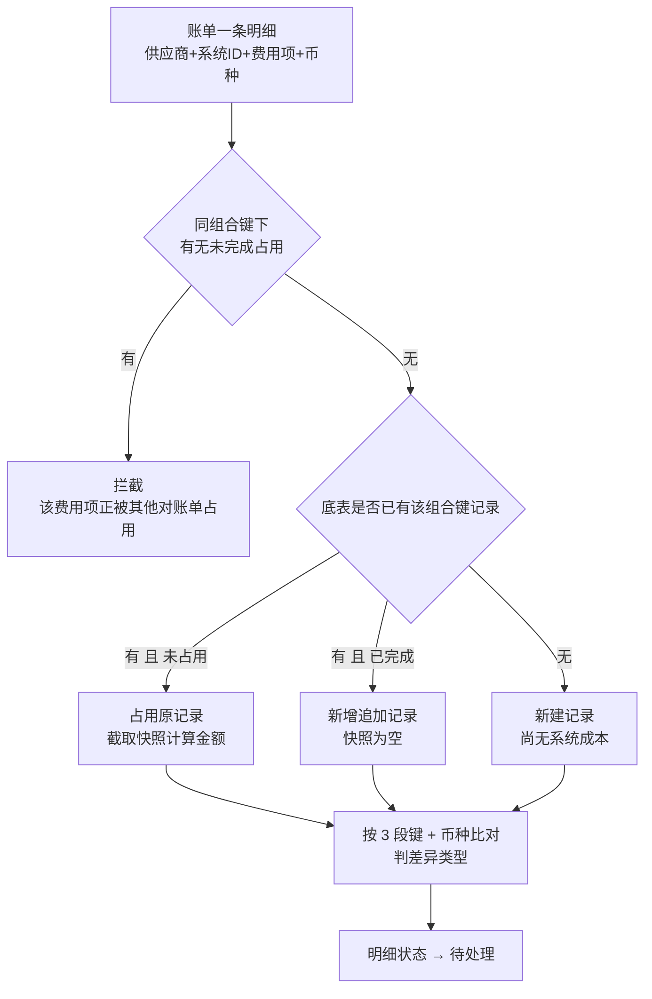

# 03 对账中处理

> 本章是对账作业的主战场，讲「怎么把一张对账单的差异处理干净」：**开始对账 → 看明细 → 定结算策略 → 导出明细 → 批量改 → 作废 → 重新对比 → 取消对账**。差异是怎么判出来的规则不在这里重复，见附录 A。

---

## 3.1 开始对账

**什么时候做**：对账单状态为【待对账】，且账单头信息已核对无误。点了这一步，账单才算真正和系统数据挂上。

**在哪做**：对账单详情页「金额汇总」标题栏右侧的操作区，「开始对账」（状态为待对账时显示）。

**怎么做**：点击后弹二次确认，提示将占用底表记录、截取快照并跑差异判定。确认后系统逐条处理账单明细。

这里有两个键，别混：

- **占用底表用 4 段**：`供应商编码 + 系统ID + 费用项 + 币种`。按这个组合去找、去占用；
- **判差异用 3 段**：`供应商编码 + 系统ID + 费用项`，**不含币种**——币种是找到记录之后再比对的条件。判定细节见附录 A。

币种单独拿出来，是因为币种对不上时不能直接比金额（跨币种比金额没有意义），要先判成「对账币种不一致」，快照留空。

三种匹配结果的含义，直接决定后续会看到什么：

| 匹配结果 | 系统动作 | 页面表现 |
| --- | --- | --- |
| 找到记录且未占用 | 占用该记录，写入对账单ID、账单金额、关联ID，截取快照 | 正常明细，差异类型按金额对比走 |
| 找到记录但已完成过对账 | 新增一条追加记录，归属本单 | 快照计算金额为空，通常判为「历史已对账」 |
| 底表没有这条 | 新建一条记录（此时这条记录还没有系统成本） | 快照为空。差异类型按 3 段键再查一遍定：查不到才是四种「查不到」之一（费用项无计费 / 供应商不一致 / 单据无计费 / 成本系统无单据，按附录 A 的三层排查定位）；若查到同单号同费用项但币种不同的记录，判「对账币种不一致」 |

**做完会怎样**：

- 对账单状态 → 【对账中】，写入开始对账时间；
- 所有明细状态 → 【待处理】，快照计算金额已固化，差异类型已判出；
- 该过程系统微秒级完成，没有可见的中间状态。

**注意**：

- **导入不占用底表**。草稿和待对账期间，这些底表记录仍可被别的对账单抢占，所以导完尽快推进，别放着。
- **被拦截是常态，不是报错**。提示「该费用项存在未完成对账的占用（对账单XXX），请先完成对账」时，说明同一笔成本正被另一张对账单占着——先去把那张单完成对账，再回来处理这张。
- **只要有一条明细撞上占用，整张单都不执行**，不会出现“一半已占用”的中间状态。对方那张单完成后，重新点一次「开始对账」即可。
- **供应商是隔离的**。底表里同一个系统ID、同一个费用项，如果归属的是别的供应商，本单不会去占用它，而是按本单供应商新建记录，最终判为「供应商不一致」。这不算数据错，是两个供应商各记各的。
- **系统ID为空的明细**照常处理，会新建记录并判为「成本系统无单据」，常见于账单里填的单号系统查不到。

---

## 3.2 看懂详情页和明细页

**什么时候做**：开始对账之后，逐条定策略之前。

**在哪做**：从对账单列表点 ID 进入详情页 → 金额汇总表的「处理明细」进入明细页（自动带上该账单类型 + 币种的过滤）；或从明细页切回全量看。

**怎么看**：分两个页面看，别在同一个页面里找三层——

| 层次 | 在哪 | 有什么 | 用来判断 |
| --- | --- | --- | --- |
| 账单头 | 详情页基础信息区 | 供应商、账单日期、会计期间、状态 | 这张单是不是本次要处理的那张 |
| 金额汇总 | 详情页，按账单类型分组，不同币种拆行 | 账单金额、快照计算金额、计算差异、付款金额、付款差异；**页面没有小计 / 总计**，要合计得自己加 | 钱差在哪一类费用上，先去处理大头 |
| 逐条明细 | 明细页（从汇总表的「处理明细」进入） | 一行一个「系统ID + 费用项」，含差异类型与结算策略；**页面没有合计行**，要看合计回详情页的金额汇总（那里每一行就是该账单类型的合计） | 每笔具体怎么结 |

**一行怎么读**：按「供应商怎么报 → 系统算多少 → 判成什么 → 怎么结」四步走。关联ID 和账单金额来自供应商账单；系统ID 由账单单号匹配得到，快照计算金额来自成本系统；差异类型由系统判定；结算策略和付款金额由人工确定。字段全量清单见附录 B.2，这里不重复。

**做完会怎样**：这一步只读不改。要点是**看清差异类型再看金额**——差异类型决定这条值不值得继续查（比如「无差异」直接按账单付，「成本系统无单据」就得先确认单号），不是用来把两个数凑平的。

**注意**：

- 明细只展开**账单里有的费用项**；系统算了但账单没报的费用项不会出现在这张单里。
- 账单金额为 **0** 的费用项仍会展示——0 不代表没有这笔费用，它可能是供应商的免费项，也可能是漏收，一样要给策略。
- 差异类型共 11 种，各自判定逻辑见附录 A；本节不需要背。

---

## 3.3 定结算策略

**什么时候做**：只要这张单还没完成对账，任何明细都能改策略。**必须给出策略的是【待处理】和【已变更待复核】**——这两类手上没有策略，放着过不了完成对账的校验。【已处理】是已经定过的，想改也能改（换成别的策略，或选「空」退回待处理）。

**在哪做**：明细页顶部操作区——勾选明细 → 选「结算策略」下拉 →「确认处理」。批量用「根据查询条件确认处理」。

**怎么做**：

下拉里共 7 项：**空** + 6 种具体策略（按账单金额支付 + 争议 / 不争议，按系统金额支付 + 争议 / 不争议，不支付 + 争议 / 不争议）。清账不在下拉里，它只能由清账单流程写入。

| 所选策略 | 付款金额自动变成 | 明细状态 |
| --- | --- | --- |
| 按账单金额支付（争议或不争议） | 账单金额 | 已处理 |
| 按系统金额支付（争议或不争议） | 快照计算金额 | 已处理 |
| 不支付（争议或不争议） | 0 | 已处理 |
| 空 | 清空 | 待处理 |

付款金额由系统按策略带出，无需填写。

**做完会怎样**：策略写入、付款金额带出、明细状态推进为【已处理】；这张单的金额汇总和付款差异随之变化。

**注意**：

- **「空」是下拉里的一个正经选项**，不是"没选"。选「空」= 清空策略、付款金额置空、状态退回待处理。选错会把已定的策略抹掉。
- **快照计算金额为空时，「按系统金额支付」两项选不了**。因为没有系统金额就没有可付的钱——这类明细通常是「历史已对账」「成本系统无单据」「对账币种不一致」。
- **一旦完成对账，整张单锁定**，策略不可再动。
- 「根据查询条件确认处理」**作用域是整个查询结果，不是勾选项**。条件设错会批量改错一整批——点之前先核对条数。

---

## 3.4 导出明细

**什么时候做**：要跟供应商对某几笔、线下查某条差异的原因，或者准备用处理文件批量改——先导出拿到明细ID 和当前值。

**在哪做**：明细页工具栏「导出Excel」，按**当前筛选结果**导出。

**导什么**：明细ID、账单类型、系统ID、关联ID、关联类型、费用项、费用项编码、币种、账单金额、快照计算金额、计算差异、差异类型、结算策略、付款金额、作废标记、明细状态、对账单ID，以及账单明细对比参数。

尾程派送账单会额外带上核对参数：渠道代码、产品代码、客户代码、核重（账单 / 系统）、计费重（账单 / 系统）、是否偏远（账单 / 系统）、计价分区（账单 / 系统）、包裹轨迹状态、上网时间、签收时间。非尾程账单不带这些列。

**改完能直接当处理文件的底稿**：处理文件模板要的六列（明细ID、关联ID、关联类型、系统ID、结算策略、作废标记）导出的表里都有——删掉模板用不到的列，把要改的那一列填上，就是一份可以提交的处理文件（见 3.5）。

**注意**：

- **导出是含作废明细的**，并标注「已作废」——这样导出条数能和供应商原账单对得上。如果只想要有效明细，先按作废标记筛一下再导。
- 导出受当前筛选条件限制。想导全量就别设条件。
- 「账单明细对比参数」是把账单和系统两边的计费重、体积重、是否偏远等逐项对比的结果，是线下追差异原因的主要依据。

---

## 3.5 用处理文件批量改

**什么时候做**：要改的明细有几十上百条，或者要批量改系统ID、批量作废，逐条点不现实。

**在哪做**：对账单详情页的「处理文件」区——下载模板 → 线下填 → 选择文件 → 提交文件。

**怎么做**：模板有六列（明细ID、关联ID、关联类型、系统ID、结算策略、作废标记）。其中**明细ID 必填；关联ID 与关联类型只用于识别行，系统不校验也不更新**。

核心规则只有一条：**系统ID、结算策略、作废标记三列互斥，一行只能填一列，其余留空**。一行就是一次修改请求，不能一行改三样。

两列各有各的填法限制，先看清再填。

**系统ID 列只对空值明细有效**：只有当前**系统ID 为空**的明细才能填值更新；**已经有系统ID 的填了会校验失败**，那行过不去。空值集中在「成本系统无单据」这类明细上——单号在成本系统里没匹配上，系统ID 才会留空。

策略列的三种填法最容易搞错，务必分清：

| 结算策略列 | 系统理解为 | 结果 |
| --- | --- | --- |
| **留空（什么都不填）** | 不修改 | 保留原策略，不做任何改动 |
| **填汉字「空」** | 清空策略 | 策略置为「空」，付款金额置空，明细状态回退待处理 |
| 填 6 种枚举值之一 | 更新策略 | 写成该策略，付款金额随之带出 |

**做完会怎样**：每次提交在表格里新增一行，状态经历 待执行 → 执行中 → 执行完成 / 执行失败。

- 全部校验通过：显示「批量修改成功，共处理 X 条明细」；
- 有校验失败：显示「下载校验结果文件」，文件包含**全部行**，逐行标注通过还是失败原因。

**只要有一行失败，整份文件都不执行**——通过的那些行同样不会落库。所以别只看失败行，改完必须整份重新提交。

**校验失败时怎么改**：不用事先记住会碰到哪几种错，按这个方法走——

1. 点「下载校验结果文件」，里面是本次提交的**全部行**，逐行标了通过还是失败原因；
2. 只看失败的那几行，按它写的原因回明细页核对：明细ID 是不是本单的、填的单号在成本系统里查不查得到、填的值是不是在允许的范围内；
3. 改完整份重新提交即可。改的范围只看文件里出现的明细ID——没写进去的明细不会被改动；同一条明细提交过多次，取最后一次填的值。

**注意**：

- **只有【对账中】能导入**。其他状态下整份文件被阻断，里面一行都不会执行。
- **系统ID和结算策略这两列，先后顺序有讲究**。系统ID一改会重新匹配底表、重截快照、重跑差异判定，差异类型可能整个变样——这时同一行若还带着策略，策略就落在一个已经变了的差异上。所以先改系统ID，等差异重算出来，再定策略。

---

## 3.6 作废与取消作废

**什么时候做**：某几条明细要从本期账单里剔除，不参与本期结算。典型场景是**拆单**——同一张供应商账单里有一部分要拆到另一张单去单独结算，被拆出的明细在本单标记作废。

**在哪做**：明细页「作废」模块的四个按钮——「作废」「根据查询条件作废」「取消作废」「根据查询条件取消作废」；也可以用处理文件批量填作废标记。

**做完会怎样**：标记作废后，**本单把这条剔除**——不出现在本单汇总、不计入差异。但**底表占用保持不动**，明细与对账单的关联也还在，所以随时能取消作废。

底表什么时候释放：**完成对账时统一释放**。释放时做两件事——

| 动作 | 结果 |
| --- | --- |
| 原占用记录 R 释放回池 | 清空对账单关联、明细状态置初始，成本字段保留，可被新账单重新占用 |
| 新增作废追加记录 R' | 保留归属关系、作废标记=作废、明细状态=已完成、账单金额留原值；仅用于底表追溯，不参与统计 / 清账 / 计提 |

**注意**：

- **作废不等于数据消失**。在完成对账之前，这条成本在底表侧仍然算数（统计表会算它），只是本单不认它。完成对账释放后才真正从统计里退出——**统计口径的分界线就是「完成对账」**。
- **取消作废就是把这条重新计入本单**。底表占用和关联从头到尾没断，取消标记后直接恢复，不会和别的单冲突，也不需要重新对账。
- **只有【对账中】能改作废标记**。作废的前提是这条明细已经被本单占用、正处在对账里；待对账阶段还没占用底表，没有可作废的对象。已完成锁定，改不了。
- **「根据查询条件作废」的作用域是查询结果，不是勾选项**。和「根据查询条件确认处理」是同一个坑——条件设宽了会整批作废。

---

## 3.7 重新对比无结算策略明细

**什么时候做**：开始对账之后，单据侧成本又变了（费率调整、补录计费、单据更新），而本单的快照和差异还是开始对账时的旧值，需要让它们跟上最新成本。

**在哪做**：明细页顶部「重新对比无结算策略明细」——仅【对账中】显示。

**怎么做**：点按钮 → 二次确认 → 确认后提交后台**异步**执行：重截快照、重跑差异判定。**提交后不会立即出结果**，处理完成前明细页显示的还是旧的快照和差异类型。

**参与范围**是这两条同时满足：**结算策略为空** + **未作废**。也就是只有【待处理】和【已变更待复核】会参与。

**做完会怎样**：重截快照计算金额、重跑差异判定，然后按结果更新状态：

| 重跑结果 | 明细状态 |
| --- | --- |
| 差异类型变了 | 转【已变更待复核】，等待复核 |
| 差异类型没变 | 保持原状态（待处理还是待处理，已变更待复核还是已变更待复核） |

对账单状态始终保持【对账中】不变。

**注意**：

- **已经给了策略的明细不会被刷新**。想让某条也参与重对比，先把它的策略选成「空」退成待处理。注意这是「重新对比」的限定——用处理文件改系统ID是另一条路径，那条会连带重算，不受策略限制（见 3.5）。
- **它是异步的，提交后不要反复点**。处理要跑一会儿，完成前看到的还是旧值——等一会儿刷新明细页再看结果，别因为「没变化」就以为没点上、连续重复提交。
- 【已变更待复核】不是错误状态，只是提醒"这条的数字变了，需重看一遍再定策略"。

---

## 3.8 取消对账

**什么时候做**：这张单整体有问题——供应商发错账单、账期对不上、发现大范围明细不对，继续往下处理没意义。

**在哪做**：对账单详情页「金额汇总」标题栏右侧的操作区，「取消对账」（状态为对账中时显示）。

**做完会怎样**：退回【待对账】，同时清掉这些东西：

| 会被清掉 | 说明 |
| --- | --- |
| 底表占用 | 追加记录直接删除；最早记录解绑保留（清空对账单信息） |
| 快照计算金额 | 清空，下次开始对账重新截 |
| 结算策略与付款金额 | **全部清空**，之前定的策略一条不留 |
| 作废标记 | 一律置回正常 |

对账单头和明细结构保留（软取消），所以可以直接重新点「开始对账」，不用重新导入。

**注意**：

- **策略会被清空且不恢复**。如果只是想让某几条重算，用 3.7 的重新对比，不要整单取消——取消意味着前面所有的策略工作要重做一遍。
- 取消后作废标记也被复原了，原来作废的明细会重新出现在本单汇总里。
- **只能对【对账中】的单使用**。已完成是终态，没有「取消对账」入口。
