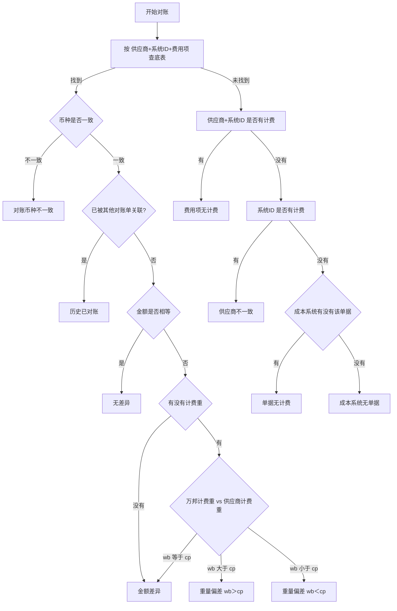

# 附录 A 差异类型判定

> 本附录供查阅：差异类型是怎么判出来的。正文各章只讲「看到这个类型该做什么」，判定规则统一放这里。

---

## A.1 差异类型一览与判定逻辑

判定统一以 `供应商编码 + 系统ID + 费用项` 为查找键（**不含币种**），去对账明细底表找记录。币种不参与查找，而是找到记录之后再比对。

> 注意这跟开始对账时**占用底表**用的键不是同一个：占用按 `供应商编码 + 系统ID + 费用项 + 币种` 四段（含币种），判定按三段。两者分工见 3.1。

| 差异类型 | 判定逻辑 |
| --- | --- |
| 对账币种不一致 | 找到记录，但币种与账单币种不一致（此时快照计算金额为空） |
| 历史已对账 | 找到记录且币种一致，但该记录已被**其他对账单**关联 |
| 无差异 | 币种一致、未被占用，快照计算金额 = 账单金额 |
| 金额差异 | 币种一致、未被占用，金额不等，且没有计费重或两边计费重相等 |
| 重量偏差（wb＞cp） | 金额不等，有计费重，且万邦计费重 > 供应商计费重 |
| 重量偏差（wb＜cp） | 金额不等，有计费重，且万邦计费重 < 供应商计费重 |
| 费用项无计费 | 按三字段找不到记录，但按「供应商 + 系统ID」不限费用项能查到有金额的记录 |
| 供应商不一致 | 按「供应商 + 系统ID」查不到，但按「系统ID」不限供应商能查到有金额的记录 |
| 单据无计费 | 按「系统ID」不限供应商都查不到有金额的记录，但成本系统里存在该单据 |
| 成本系统无单据 | 按「系统ID」查不到有金额的记录，且成本系统里也不存在该单据 |
| 清账 | 清账单流程直接写入，不走任何判定 |

> **两套金额口径分工**：涉及金额比对的类型（无差异 / 金额差异 / 重量偏差）一律用**快照计算金额**；「有没有计费」的排查用**最新计算金额**。不要混。

---

## A.2 判定流程图

**读图的思路**：先查底表，匹配上就走金额比对主流程；匹配不上就按「供应商 + 系统ID」→「系统ID」→「成本系统单据」三层逐级往下缩小范围，定位到底缺在哪一环。

**触发时机**：开始对账时逐条判一次；重新对比时对参与明细重判一次（已经给了结算策略的明细不参与重判）。用处理文件改系统ID是另一条路径，会重新匹配、重截快照、重跑判定，不受策略限制。

---

## A.3 边界场景补充规则

| 场景 | 怎么判 | 结果 |
| --- | --- | --- |
| 有计费记录但金额是 0 | 按「有没有这条记录」判，不按「金额是不是 0」判。最新计算金额=0 属于有成本 | 进金额比对流程（账单也是 0 则无差异） |
| 找到记录但只有一条，币种不一致 | 只要币种和账单对不上就判不一致，不继续比金额——跨币种比金额没有意义 | 对账币种不一致 |
| 找到多条记录但没一条币种匹配 | 按账单币种匹配不到即判不一致 | 对账币种不一致 |
| 追加账单撞上已被占用的维度 | 该组合键下已无空闲记录时，新增一条追加记录，并判为历史已对账，不进金额比对 | 历史已对账 |
| 底表无记录，但同系统ID下有其他供应商的计费 | 按「供应商 + 系统ID」查不到，按「系统ID」查得到 | 供应商不一致 |

**关于「历史已对账」要理解的一件事**：它的快照计算金额是空的——因为这笔成本已经被别的账单对过一次，没有第二份成本可供比对。这个类型不是系统在说"重复出账"，而是在说"这笔钱系统已经付过，本次是否再付由财务判断"。所以对应的策略通常是「不支付」。
